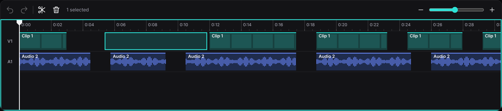
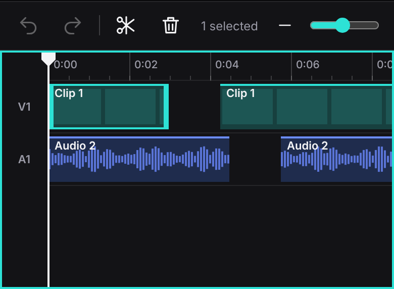

# Feature: timeline view (canvas, M1-031 / spike S8)

## Behaviour
Canvas-rendered timeline in the editor's timeline panel: time ruler with adaptive tick labels, one row per `Track` of the first `Sequence` (generic for N tracks, video and audio), clips as rectangles with name and a filmstrip (video) or waveform (audio) placeholder, sticky track-label gutter and ruler, playhead. Reads `Project` from `@app/engine-client`; shows a sample project (`timeline/fixture.ts`) until media is imported. Editing (M1-034, below) goes through `Engine.editing`; the UI never changes the project itself.

Canvas-rendered timeline in the editor's timeline panel: time ruler with adaptive tick labels, one row per `Track` of the first `Sequence` (generic for N tracks, video and audio), clips as rectangles with name and a filmstrip (video) or waveform (audio) drawn from cached bitmaps (placeholders until a `MediaLayer` is given), sticky track-label gutter and ruler, playhead. Reads `Project` from `@app/engine-client`; shows a sample project (`timeline/fixture.ts`) until media is imported. **No editing interactions yet** (M1-034).
- **Zoom** (pixels per second, 2..1200): pinch, ctrl/cmd + wheel (and trackpad pinch), `+`/`-`/`=` keys, `0` fits the project, log-scale slider and buttons. Zoom keeps the time under the pointer (or the playhead / viewport centre) fixed.
- **Scroll**: wheel (shift or no vertical overflow = horizontal), touch drag with momentum, Page Up/Down, Up/Down arrows for tracks.
- **Seek**: click/drag on the ruler or (mouse) the tracks; on touch a tap seeks and a drag pans. The playhead is followed while playing.
- **Accessibility**: the canvas is a focusable `role="slider"` "Playhead position" (arrows = 1 frame, Shift = 1 s, Home/End) with an `aria-describedby` summary (tracks, clips, length, key help). Edits are announced in a polite live region (`tl-live`). A per-clip list alternative is still open.

## Editing (M1-034)
All edits are `Op`s sent to `Engine.editing`; after each one the shared project store (`store/projectStore.ts`, M1-024) re-reads `project()` and the scene is rebuilt (timeline-ops.md). Calls are serialised in the store, which also holds the selection (ids of clips an edit or undo removed are dropped) and the playhead; the bin and the preview read the same project. Snapping and ripple are M2: not built.
- **Select**: click/tap; Shift or Ctrl/Cmd toggles; mouse drag on empty track space = marquee (Shift/Ctrl adds); tap or click on empty space seeks and deselects. Ctrl/Cmd+A all, Esc clears.
- **Move**: drag a clip (touch: tap to select first, then drag; dragging an unselected clip pans). Live preview is a ghost drawn from the gesture (the original is hidden), zero engine calls while dragging; it stops at neighbours and at 0, moves in whole frames, and a single clip can change to another free track of the same kind. Release sends ONE batch (`move` ops) = one undo step. Multi-selection moves in time only. (Engine-side coalescing exists for continuous streams; a drag does not need it, and it avoids a 200-op undo.)
- **Trim**: handles appear on selected clips. Grab zone is 44 px wide for touch (16 mouse), straddling the edge and never taking more than a third of a narrow clip, so it stays 44 px however narrow the clip is. Limits: neighbours, source length (media duration, speed), one frame minimum. Release sends one `trim_in`/`trim_out`.
- **Split** (`S`, toolbar): selected clips under the playhead, else every unlocked clip under it. **Delete** (Del/Backspace, toolbar): lift, leaves a gap (ripple is M2). **Undo/Redo**: Ctrl/Cmd+Z, Shift+Ctrl/Cmd+Z, Ctrl+Y, toolbar (disabled when there is nothing to do).
- **Keyboard** (canvas focused): with a selection the plain arrows walk clips (Left/Right on the track, Up/Down to the neighbouring track), Alt+Left/Right still steps the playhead; Enter picks the clip at the playhead; `,` `.` nudge a frame (Shift = 10); `[` `]` trim start/end to the playhead; Alt+`,`/`.` trim the end by a frame (Shift: the start). Without a selection arrows move the playhead as before.
- Locked tracks: selectable, never edited ("That track is locked").
- Rejected edits (engine error) leave the project unchanged, show a toast and are announced.

## Clipboard, numeric timing, history (TL-02 / TL-06)
No new engine ops: everything is existing ops (`insert_clip`, `delete`, `trim_in`, `trim_out`) in ONE batch = one undo step, planned by pure code in `timeline/clipboard.ts` (tests: `timeline-clipboard.test.ts`; Rust: `duplicate_paste_and_cut_are_single_undo_steps_of_existing_ops`, `numeric_trim_sets_exact_boundaries_and_undoes`). A second toolbar row (44 px targets, no hover-only controls) holds Duplicate, Copy, Cut, Paste, Clip timing, History; keys Ctrl/Cmd+D/C/X/V.
- **Duplicate**: copies of the selection placed right after the group's last end on the same tracks; if that overlaps, the whole group slides to the next free slot. The copies become the selection.
- **Copy / Cut / Paste**: in-app clipboard (copies, independent of later edits). Paste puts the earliest clip at the playhead, keeping offsets; the track is the selected clip's track when the clipboard came from one track of the same kind, else each clip's own track. Locked, missing or wrong-kind tracks are skipped and reported; overlaps slide later, never overwrite. Cut = copy + delete (editable clips).
- **Clip timing** (one clip selected, unlocked): dialog with Start, End, Length as `MM:SS:FF` (`parseTimecode`: also `SS:FF`, `H:MM:SS:FF`, bare frames). Each Set is one trim (start -> `trim_in`, end/length -> `trim_out`); outside the allowed range (neighbours, source length, one frame) shows the range, no silent clamp.
- **History**: dialog listing the session's steps oldest first (names from the undo labels: "Import of clip.mp4", "Split 1 clip"...), current step marked, undone steps dimmed; tap to jump (`ProjectStore.jumpTo`: undo/redo the difference in one queued job). A recovered session shows one "Earlier edits" row (older steps are not named) on purpose: the journal stores the ops of each step but not its label (that is UI text given at commit time), and deriving names from op kinds would need a new engine API on both backends and give worse names than the live ones). Bottom sheet on a phone, card on a desktop; native `<dialog>` (Esc, focus return).
- **Ripple delete** stays M2 (needs the ripple op, TL-04); delete lifts and leaves a gap.

## Structure (`apps/web/src/timeline/`)
- `scene.ts`: `Project` -> flat typed arrays (seconds as floats for drawing only; the model keeps integer ticks, ADR 0010), clips sorted per track, binary search.
- `view.ts`: viewport math (zoom-at-anchor, clamping, slider mapping, tick step, fling decay). `hit.ts`: pure hit-testing (ruler, gutter, clip body/edge, gap, empty) reused by M1-034. Both unit-tested in `tests/unit/timeline.test.ts`.
- `edit.ts`: pure limits, frame snapping and op builders. `interact.ts`: pure pointer state machine (events -> gesture + effects). `shortcuts.ts`: key -> command. `hit.ts` also has `handleAt`. `store/projectStore.ts` (app level): the one engine-backed project, selection and playhead.
- `draw.ts`: painter; `TimelineCanvas.tsx`: sizing at real devicePixelRatio, input, rAF-on-dirty.

## Waveforms and filmstrips (M1-013, `timeline/media-layer.ts`)
Kept in their own module so interaction work on `draw.ts` does not collide: `drawTimeline(..., media?: MediaLayer)` calls `drawWaveform` / `drawFilmstrip` per visible clip when a layer is passed (the canvas takes it as the `media` prop).
- **Audio**: 512-column tiles (`media/waveform.ts`), rendered once from `PeaksView.columns` into an offscreen canvas at the lane height times dpr, aligned to media time (so scrolling never shimmers), one tile column = 2^b frames with b = floor(log2(frames per screen pixel)) (at most one column per pixel, at least 32 frames). A draw is one `drawImage` per visible tile. While data has not arrived the clip shows a one-pixel baseline; as partial peaks arrive (every ~400 ms) only tiles that cover new data re-render (tiles over finished data are final and never redrawn). Tiles are LRU-trimmed at 64 MB and dropped when the theme colour or dpr changes.
- **Video**: thumbnail slots at the `INTERVALS` step for the zoom, each a "cover" crop of its bitmap; slots without a bitmap yet are `videoTile` rectangles. Only the visible slots of visible clips are requested.
- **Theme**: `paletteFromCss` now builds the palette from `readColors` (clip, accent, accent-soft, surface-3, muted, fg), so light, dark and high-contrast follow the tokens.
- **Lean mode**: while the view moves and frames take more than 28 ms, filmstrips draw as plain placeholder slots and return 120 ms after motion stops (fast devices never enter it). Waveform tiles are capped at 2x pixel ratio and drawn without smoothing; thumbnails also without smoothing.
- **Hosts**: `Timeline` builds the layer with `routeMedia(fixtures, real)`: the sample project (`fixture:` uris) keeps the synthetic `FakeMediaHost`; imported media goes to `importedMediaHost(engine, fileOf)` (`media/engine-host.ts`), which opens the bin's file through `Engine.media` once per media. Imported clips show placeholders only while peaks/thumbnails extract; media that is offline or cannot be decoded stays a placeholder (fail soft, no error UI). Thumbnails are turned upright by the file's display `rotation` (`thumbPlan`), so portrait phone clips read correctly.
- **Diagnostic hook**: the timeline canvas carries `data-wave-tiles` and `data-thumbs` (counts of rendered waveform tiles and filmstrip frames); the smoke test waits for both to be non-zero after an import.
- Screenshots: `img/m1-013-wiring-desktop.png`, `img/m1-013-wiring-phone.png` (imported clip with real filmstrip and waveform).
- Not handled yet: media that was offline when first requested stays a placeholder until reload (no retry after relink); clip speed other than 1x (waveform and thumbnails are laid out at 1x), timeline-side effects like gain or fades on the waveform.

## Performance (budget: docs/PERFORMANCE.md "Timeline UI")
1000 clips x 20 tracks: 60 fps desktop, 57-59 fps at 4x CPU throttle, 34-41 fps on a phone-size dpr-3 viewport at 4x throttle (software raster). Details and method: ADR 0007 "S8 results". Run `node tests/perf/timeline-bench.mjs` (after `npm run build`).
**Drag input-to-paint** (event handler + draw + raster flush per pointer move, 1000 clips x 20 tracks, `tests/perf/timeline-bench.mjs`): desktop p95 3.1 ms (1 clip) / 1.1 ms (all 1000 selected); 4x CPU throttle p95 13.1 / 5.3 ms; phone dpr3 4x throttle p95 14.6 / 11.0 ms. Budget: < 16 ms.
Rules that keep it fast: draw only visible clips; no per-frame allocation; avoid path fills of many small shapes (use `fillRect`); no DOM per clip.

## Edge cases
Empty project draws ruler only; unsorted clips are sorted at build; very small clips are 1 px minimum and unlabeled; names are drawn only when they fit; clips left of the gutter are clamped under it.

## Test plan
Unit (`tests/unit/timeline-edit.test.ts`): snapping, move room, op order, track fit, trim ranges, split/delete ops, navigation, handle zones, every gesture (select, toggle, drag, track change, touch rules, trim, marquee), shortcuts. Smoke: select, split, delete, undo/redo (phone and desktop), drag, trim handle and keyboard (desktop). Also: scene build, search, hit-testing with scroll, zoom anchor, slider, tick step. Smoke: canvas paints non-blank pixels, summary present, keyboard zoom/scroll. Perf: the bench script above.

## Polish (toolbar, focus, startup)
- **Narrow toolbar**: at <= 480 px the zoom slider and the selection label are hidden; the 44 px zoom -/+ buttons stay (smoke: "+" visible and inside the viewport at 320 and 390 px).
- **Focus frame**: the canvas shows a softened inset frame (focus token) only for keyboard focus; focus given by a pointer press shows none (`data-pointer`). Screenshots: `img/timeline-focus-before-pointer.png`, `img/timeline-focus-after-pointer.png`, `img/timeline-focus-after-keyboard.png`.
- **Undo/redo state after recovery**: the toolbar reads it from the store, which `App` seeds from the recovered session (`replayed > 0` means there is history to undo); "Undo recovery" starts a fresh history.
- **Startup**: the export dialog (`export/ExportDialogView.tsx`) is a lazy chunk, warmed on hover/focus of the Export button; first-load JS 126 -> 121 KB gzip (the i18n catalogue is now its own chunk). All JS incl. the engine worker is ~275 KB gzip and is dominated by the worker (130 KB), not the UI.

**Thumbnails also feed the preview.** Every thumbnail `ThumbService` loads is announced on `media/thumbBus.ts` (media id, seconds, bitmap); the preview host copies it to the preview Worker, which shows the nearest one as a scrub stand-in while the exact frame decodes (`docs/features/preview.md`). No listener = no cost; the timeline does not depend on it.
