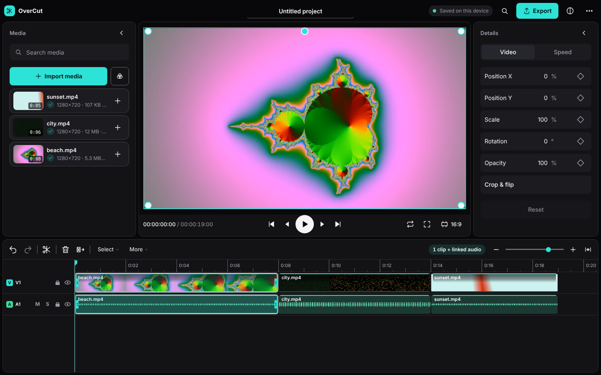
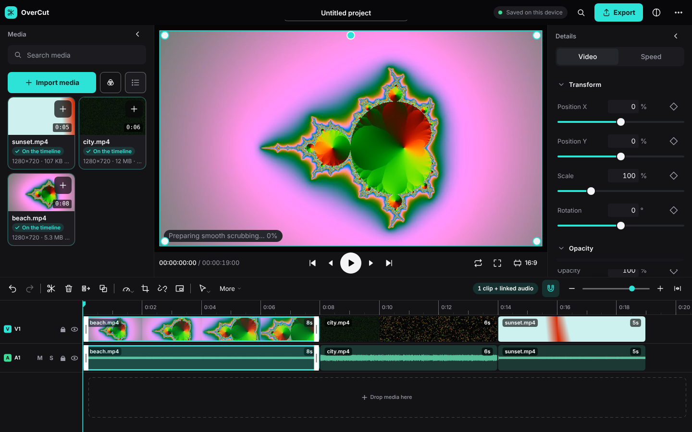
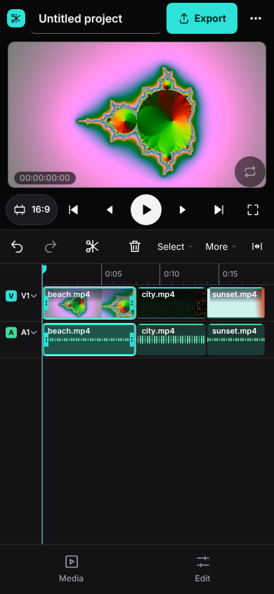
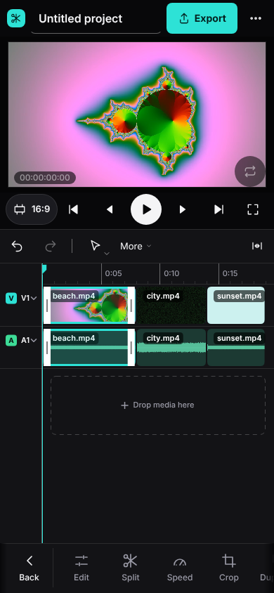

# M2 UX round 14: "feels like a pro editor" brief

Owner ask (2026-11-28): make the M2 UI/UX impeccable, using the ui-ux-pro-max skill's guidance. It should be pretty, fast and comfortable to use, review and operate. No earlier design choice is sacred. The bar to beat is CapCut. This brief is the shared target for the three r14 lanes. Each lane is one PR against `m2`.

## What the audit found (m2 @ 844c70e; desktop 1440x900, tablet 1024x768, phone 390x844; dark and light)
The flows work, and 13 rounds of fixes made it correct and accessible. It still **looks like a settings page, not an editor**:
1. **Shell**: floating rounded cards with gaps and drop shadows around Media, Preview, Details and Timeline. Pro editors (CapCut, Resolve, Premiere) use flush panels with 1 px dividers, so the picture and the timeline get every pixel. The light theme reads as a SaaS dashboard. On a first run, an editor should open dark.
2. **Timeline is the product, and it is the weakest surface**: 52 px lanes with a tiny text label sitting on top of the filmstrip, a waveform drawn as a dotted hairline, a thin 1 px playhead with no head, and half the panel left empty under two tracks. In CapCut the clips are the hero: tall filmstrips, rounded clips, a bold selection with white trim handles, a filled waveform, and a playhead with a grab head.
3. **Operating it is menu-driven**: the timeline toolbar is Undo/Redo, Split, Delete, Detach, then the text menus `Select ▾` and `More ▾`. Speed, Duplicate, Freeze, Crop, Ripple delete and Overlay are all buried in `More` (on a phone, a 14-row sheet). CapCut puts the actions for the selected thing one tap away, as icon+label tools.
4. **Phone**: the bottom bar has only Media | Edit. Editing a property opens a sheet that hides the timeline. CapCut's phone model works: a fixed centre playhead with the timeline scrolling under it, and a bottom tool strip that switches to the selected clip's tools (Split, Speed, Volume, Crop, Duplicate, Delete, ...). Property panels are short sheets that leave the timeline visible.
5. **Details panel**: it is a list of number rows. Pro editors group the values (Transform, Opacity, Crop, Speed) and give each one a slider plus a number. The keyframe diamond sits beside each value.

## Design direction (from ui-ux-pro-max, `--design-system "video editor creative tool dark immersive pro"`, density 8, motion 4)
- **Style**: dark OLED-grade neutral and content-first. The picture is the only colour; the chrome stays quiet. Dark is the default on first run, and light and high contrast stay available in the theme menu (the skill rates light "not recommended" for this product type).
- **Density**: dashboard-dense on desktop with a 4/8 px rhythm and flush panels. Touch targets stay at least 44 px (`pointer: coarse`), even where controls look small with a mouse.
- **Colour**: keep the token system and the user's accent choice. Selection, focus and the playhead use the accent. Clips get distinct *kind* hues (video, audio, still or overlay) that are quiet enough that the filmstrip carries the clip. Contrast stays pinned by `tests/unit/theme-contrast.test.ts`.
- **Type**: Inter, self-hosted (unchanged). Timecode uses tabular figures, and labels are 11-13 px on desktop.
- **Motion**: 120-200 ms, transform/opacity only, and exits faster than entries. No `back.out` overshoot on dense UI (skill anti-pattern). Respect `prefers-reduced-motion`.
- **Checklist** (skill pre-delivery): SVG icons only; pressed feedback within 150 ms; disabled controls are really disabled; focus is visible; safe areas are respected; no horizontal scroll at 320 px; no hover-only control; every icon button has a name and a tooltip with its shortcut.
- **Performance is part of the look**: the timeline still repaints at 60 fps on the 1000-clip bench (`TimelineBench`), filmstrip tiles are cached (no per-frame allocation), and no layout shift appears when a panel opens.

## Lanes (one session each, one PR each against `m2`)
| Lane | Owns (files) | Delivers |
|---|---|---|
| **A: Shell and timeline look** | `theme/tokens.css`, the shell parts of `styles.css`, `timeline/draw.ts`, `timeline/scene.ts`, `timeline/header.ts`, `canvas.ts` | A flush editor shell with 1 px dividers (no floating cards) and dark by default on first run. Taller lanes (video about 64 px desktop / 56 px phone, audio about 44 px) with a filmstrip, rounded clips, a name chip that does not cover the picture, a filled waveform, a bold selection with white trim handles, and a playhead with a head. A drop-zone hint fills the empty timeline area. Tidier track headers. |
| **B: Operate (toolbars and phone)** | `Timeline.tsx` toolbar, `timeline/ToolbarMenu.tsx`, `layout/*`, the phone parts of `App.tsx`, `commands/*` (only to reuse the registry) | **Desktop/tablet**: an icon toolbar (Split, Delete, Duplicate, Speed, Freeze, Crop, Detach audio, Ripple delete) with tooltips and shortcuts. It is contextual (disabled with a reason, never hidden), with `More` kept for the rest, and toggles on the right (snapping, follow playhead) next to zoom. **Phone**: a CapCut-style bottom tool strip, icon above label and horizontally scrollable, that switches to clip tools when a clip is selected. Phone property sheets open at about 45% height so the timeline and the playhead stay visible. A fixed centre playhead on the phone timeline (the timeline scrolls under it), if it fits the existing scroll/zoom model; if not, write down why. |
| **C: Details, media and export** | `inspector/*`, `media/*`, `export/*` (dialog view), their CSS | **Details**: grouped sections (Transform, Opacity, Crop and flip, Speed) that collapse, each value a slider plus a scrubbable number with the keyframe diamond kept, and clear empty, multi-select and audio-clip states. **Media bin**: a thumbnail grid option, hover/press preview, a clear "used on timeline" badge, and drag to the timeline kept. **Export dialog**: presets that would give the same file for this project are merged ("Same as Original for this project"), it shows a preview frame, the size estimate is prominent, and the primary button is always visible. |

Shared rules: tokens only (no raw colours in components). Each lane adds or updates a smoke step and keeps `tests/smoke/a11y.spec.ts` (axe, three themes, phone and desktop) at zero serious issues. Each lane writes a short `docs/m2/ux-r14-<lane>.md` (what changed, before → after, measured cost) and updates `docs/features/design-system.md` where a rule changes. Take before/after screenshots (desktop 1440x900 and phone 390x844, dark) with `node scripts/shot.mjs` or Playwright and attach them to the PR description as a list of what changed visually. Lanes touch different files. Where `styles.css` must change, keep the edits inside your own section and rebase on `m2` before you push.

## Outcome (integration review, 2026-11-28)
All three lanes merged into `m2`: B #252, C #253, A #251. Each lane's details, costs and what it left out are in `ux-r14-a-look.md`, `ux-r14-b-operate.md` and `ux-r14-c.md`.

| | Before | After |
|---|---|---|
| Desktop |  |  |
| Phone |  |  |

Integration fixes in this PR (found by screenshotting the three lanes together at 1440x900, 1024x768 touch and 390x844 touch):
- Phone: once the clip tools moved to the bottom strip, two dividers sat side by side in the top timeline bar. The divider before the tool picker now hides with the clip tools.
- Phone: "Preparing smooth scrubbing… N%" sat on top of the timecode chip in the preview's bottom-left corner. On compact layouts it now goes at the top-left.
- Tablet: the media grid column minimum of 132 px gave one oversized column in the 268 px panel. At 116 px the grid has two columns there and still shows big thumbnails on desktop.
- Details (nothing selected): the project summary cards were inset 12 px more than the line above them. They are aligned now.

Still open after r14 (follow-ups, not in this round):
- A fixed centre playhead on the phone (issue #250): the scroll model needs a refactor first.
- Per-kind lane heights (video taller than audio): needs a row-offset table that replaces `row * LANE` everywhere.
- A freeze frame needs an engine operation (ADR + `app-timeline`). A hover-scrub of media posters needs a stored filmstrip per media.
- Tooltips on the canvas-painted track headers.
