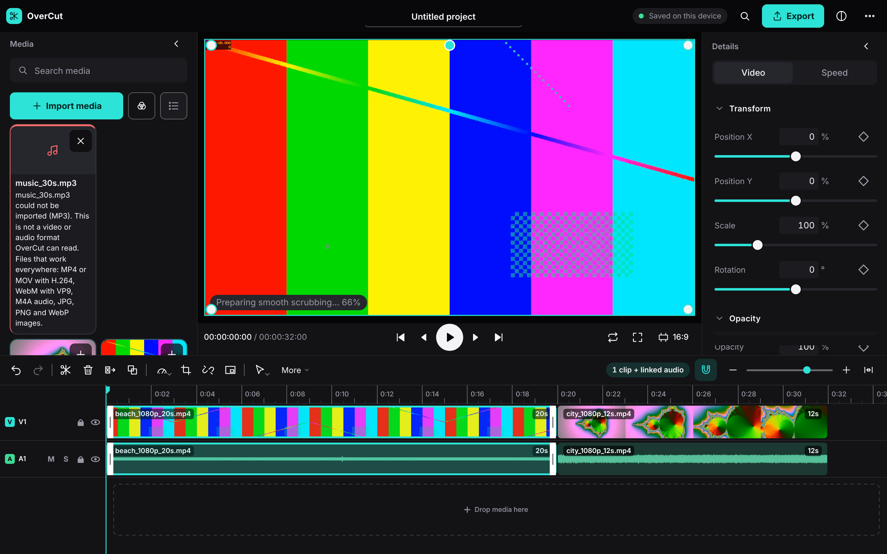
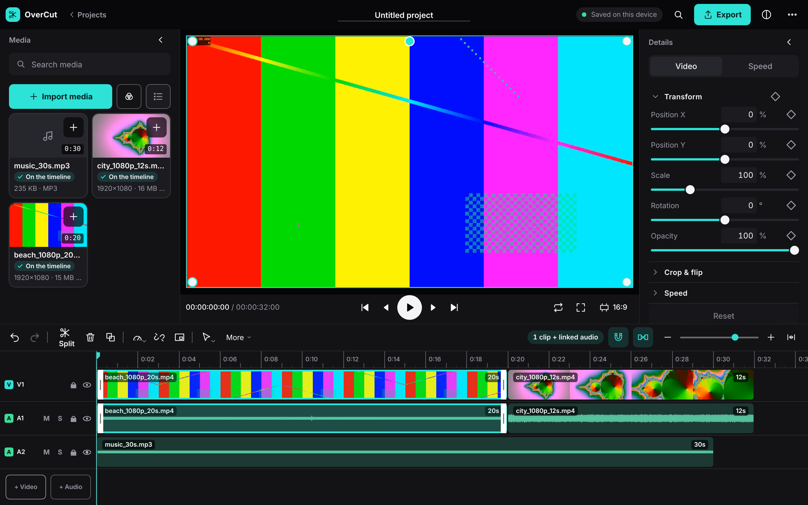
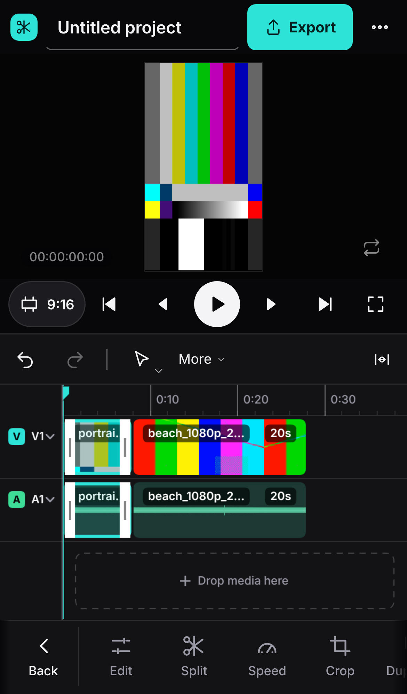
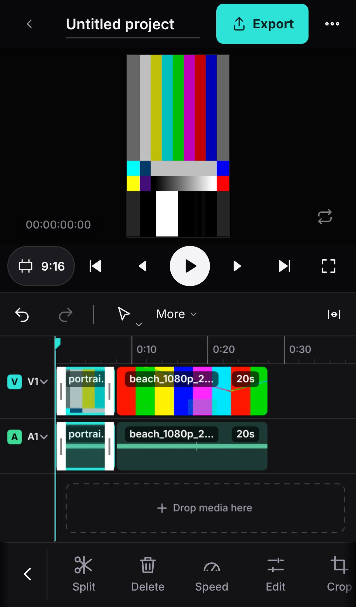

# M2 UX round 15: evidence from simulated user journeys

Owner ask (2026-11-28): make the M2 UI/UX impeccable using the ui-ux-pro-max skill. It should be pretty, performant, and comfortable to use, review and operate. CapCut is the bar, and no earlier choice is sacred. The owner asked that every change come from **evidence: real user journeys, simulated, measured and screenshotted**.

## How the evidence was gathered
Three auditors drove the built `m2` app (at 0ceb01b) with Playwright. They used realistic media: 1080p30 clips with sound, a 1080x1920 phone clip, an MP3 and a photo. Each step was timed and screenshotted, and every finding was checked against the skill's rules (`references/pro-rules.md`).
- **Desktop power user** (1440x900 and 1920x1080, mouse and keyboard). A 60 s edit with PiP, keyframes, speed and export; a keyboard-only pass; review controls; and performance on a 128-clip project and the 1000-clip bench.
- **Phone, thumbs only** (iPhone 13, Pixel 5, 360x640, landscape, 4x CPU throttle). A quick social edit, precise touch work, sheets and Back, the projects home, and responsiveness.
- **First-time user and per-surface review** (1280x800 with site data cleared, tablet 1024x768 and 768x1024). Every surface was checked in dark, light and high contrast with two accent colours.

Customer feedback from the M2 preview was added as CUST-1..6 (Windows, Chrome).

## What it found (70 items: 2 blockers, 21 major, the rest minor or polish)
**Performance already met the bar, and was kept:**
- Playback, scrub, zoom and pan: 60 fps with 0 long tasks, on 4 clips and on 128 clips.
- The 1000-clip bench: 60 fps (53 fps at 4x CPU).
- Split, select and undo: 12-35 ms.
- Cold start: 0.4 s, with CLS near 0. Drop to thumbnail: about 100 ms.
- Entry JS: 164 KB gzipped.

**The friction was in operating the app:**
- **Blockers**:
  - MP3 and WAV were advertised but refused.
  - Trimming a clip left a gap that exported as black.
- **Major**:
  - Dragging a cut between touching clips always rolled it, so a fresh import could not be trimmed.
  - Import behaved three different ways.
  - Overlay picked the wrong media silently.
  - Shortcuts worked only when the timeline had focus.
  - Portrait tablet panels overlapped.
  - Details at 1280x800 showed only 2-3 values.
  - No visible way back to Projects, and every project was called "Untitled project".
  - Phone: system Back left the app, Delete was off-screen, and property sheets hid the timeline.
- **Customer reports**:
  - Media showed "not found" after every refresh. It was really a lapsed file permission.
  - The timeline went black while the divider was dragged.
  - Linked clips could not change track, and they could not be linked again after Unlink.
  - The toolbar had too many controls.

## Lanes (one PR each against `m2`)
| Lane | PR | Delivered | Notes |
|---|---|---|---|
| B: media, import, preview, phone shell | #255 | One import rule ("Added to Media · Add to timeline"), Overlay picker, two-line error cards, "Needs permission" with one-click Allow, phone strip, Back, low sheets and ratio tiles, tablet portrait layout, the scrub ring in the player bar | `ux-r15-b.md` |
| C: Details, export, home, audio formats | #256 | MP3 and WAV import (new demuxers, ADR 0004 amended), Details that fits, export named after the project with a real frame and a stable height, Wake Lock, Projects button, auto-named projects, theme swatches | `ux-r15-c.md` |
| A: timeline editing and operating | #257 | Dragging an edge trims it, magnetic main track, Link, drop above or below to make a new track, + Video / + Audio, a simpler toolbar with grouped More, keys that work from any focus, splitter repaint | `ux-r15-a.md` |

## Integration review (all three lanes together, 2026-11-28)
Fixed while integrating:
- Tablets had lost the zoom slider. It is now a fixed 72 px and the bar scrolls.
- On phones, the Projects chevron replaces the logo, so the project name keeps its room.
- Overlay keeps its toolbar button, and Duplicate stays in More.
- **Music imported together with videos** was appended after them, starting at 0:32 and leaving 30 s of hatched black on V1. It now goes on a free audio track from the batch start, under the pictures, as CapCut does.
- **Magnetic and Snap** used nearly the same magnet icon. Magnetic now shows two clips drawn together.

| | Before (m2 @ 0ceb01b) | After |
|---|---|---|
| Desktop 1440x900, 3 files imported, clip selected |  |  |
| Phone 390x844, 2 files imported, clip selected |  |  |

## Still open (next round)
- From lane A, not done for lack of budget:
  - DESK-6: timeline height at 1440x900.
  - DESK-12 / FIRST-10: selection counts disagree between the toolbar and Details.
  - DESK-13: markers.
  - DESK-20: lane polish.
  - PHONE-13: a "back to playhead" chip.
  - PHONE-17: press feedback on clip taps.
  - PHONE-20: frame step repeating on hold.
  - Dragging an existing clip into the empty area to make a track.
- From the other lanes:
  - DESK-9 (preview lag after a gizmo release): seen only under software GL.
  - PHONE-16: landscape docking.
  - PHONE-1 (AAC export): the engine already prefers AAC; this needs a real device to verify.
  - The export gap warning: `projectGapSummary` exists, but the dialog does not show it yet.
  - One-click Save.
  - MP3 gapless trim.
- Not checkable headless: the virtual keyboard, pull-to-refresh, real Wake Lock and hardware encode speed. These go to the field validation (issue #88).
